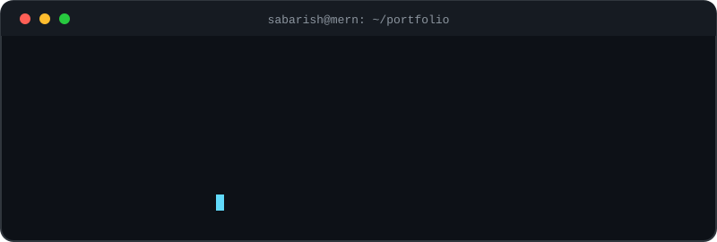
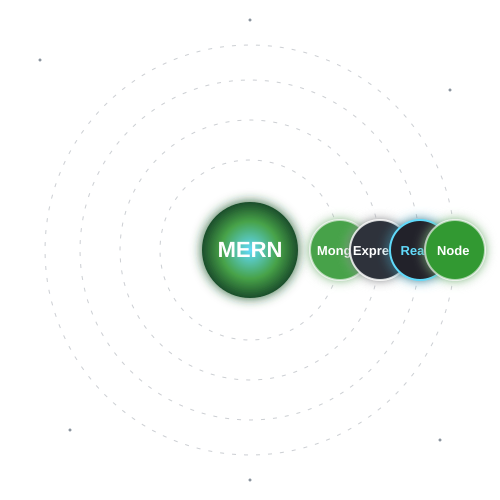

  

💻 Building scalable, responsive web applications with MongoDB, Express, React and Node.js 📚 Always learning and exploring new technologies &nbsp;|&nbsp; 📍 Coimbatore, India

## 🔗 Connect with Me
<!-- Replace the links below with your own, or delete the lines you don't need -->

## 💻 About Me (live terminal)

  

## 🛠 Tech Stack

  

**MERN Stack**

**Languages & Frontend**

**Tools**

## 📊 GitHub Analytics

  
  

  

## 🐍 Contribution Snake

  <picture>
    <source media="(prefers-color-scheme: dark)" srcset="https://raw.githubusercontent.com/Sabarishkannanp/Sabarishkannanp/output/github-snake-dark.svg" />
    <source media="(prefers-color-scheme: light)" srcset="https://raw.githubusercontent.com/Sabarishkannanp/Sabarishkannanp/output/github-snake.svg" />
    
  </picture>

## 📈 Contribution Graph

## 🚀 Featured Projects
- 🌐 [Portfolio](https://github.com/Sabarishkannanp/Portfolio) - my personal portfolio (TypeScript)
- 🤖 [Ai-crime-report-maker](https://github.com/Sabarishkannanp/Ai-crime-report-maker) - AI-powered report generator (TypeScript)
- 🧰 [Frontend-projects](https://github.com/Sabarishkannanp/Frontend-projects) - responsive frontend web apps
- ⏱ [stopwatch](https://github.com/Sabarishkannanp/stopwatch), ✅ [todolist](https://github.com/Sabarishkannanp/todolist), 🧮 [calculator](https://github.com/Sabarishkannanp/calculator) - JavaScript practice projects

## 💬 Random Dev Quote

  

⭐ Thanks for visiting my profile!

